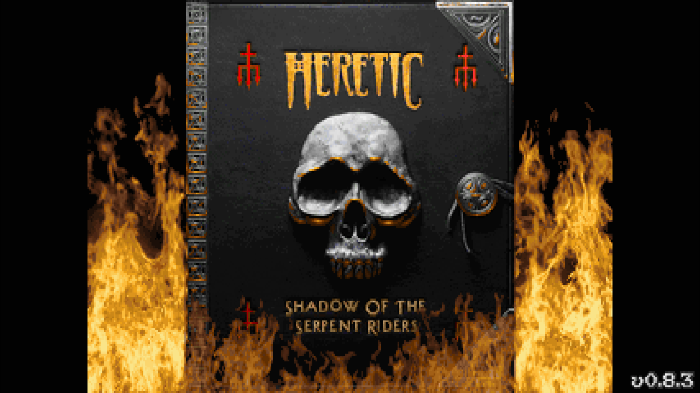
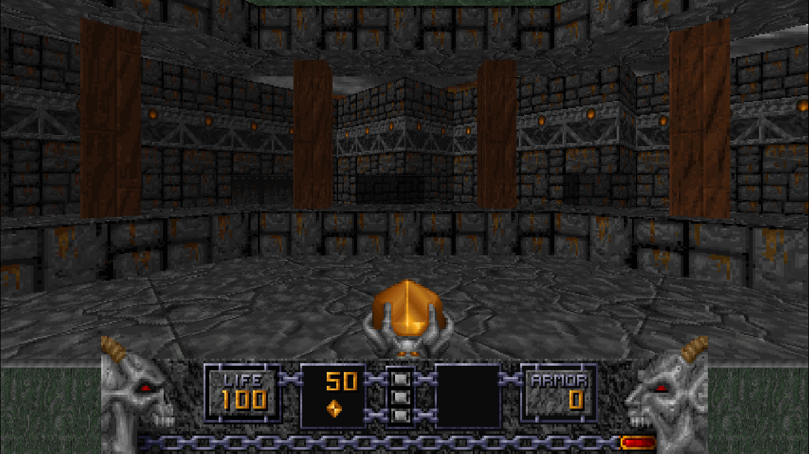
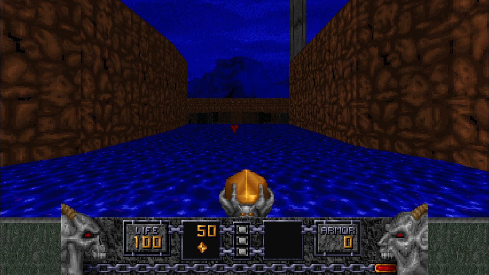
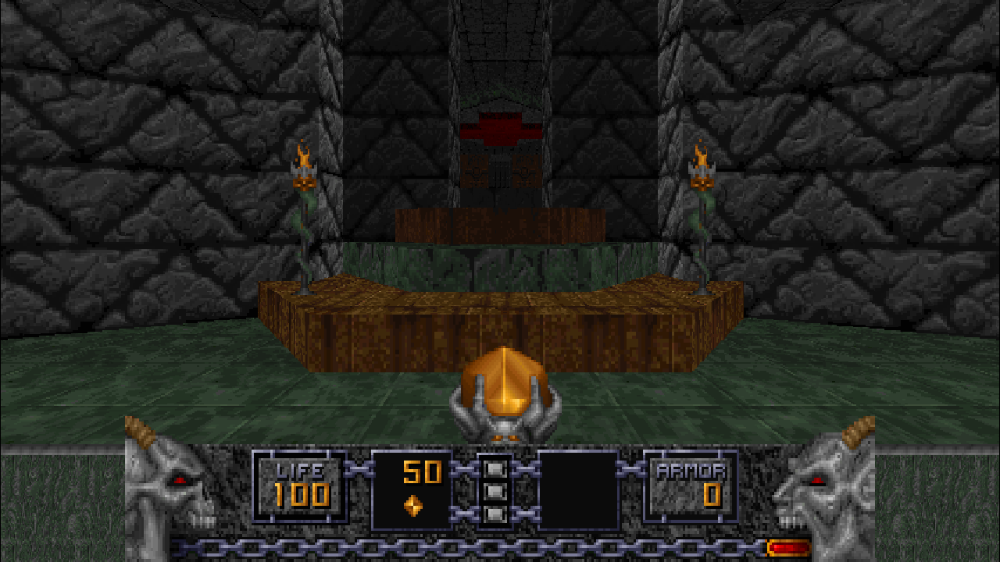
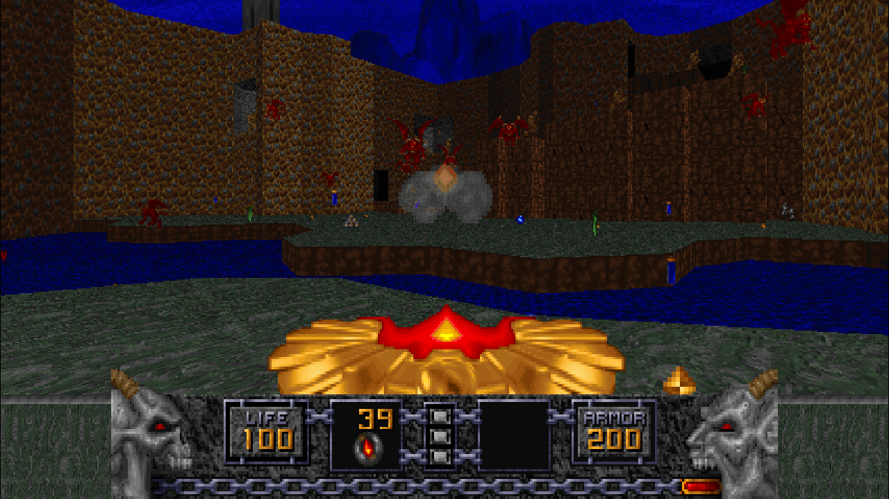
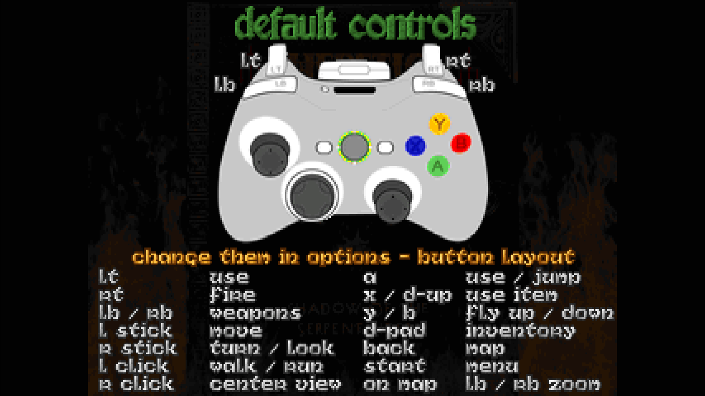
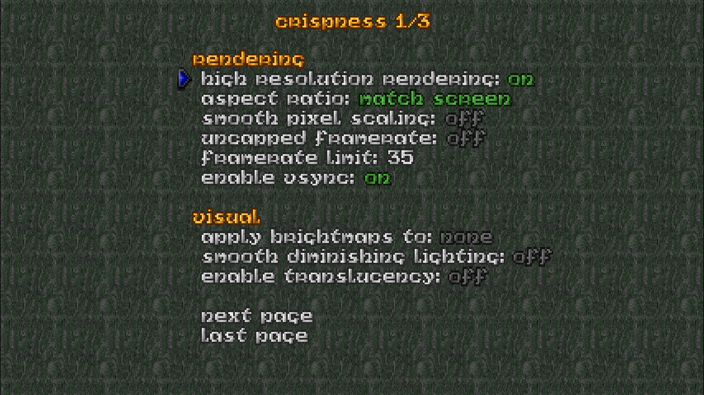
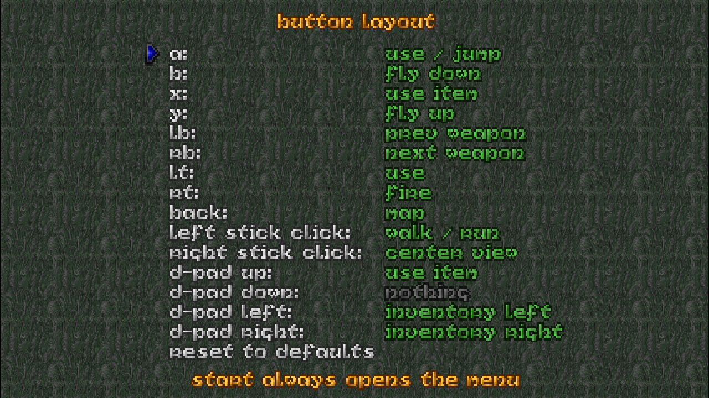

# Heretic 360

Heretic: Shadow of the Serpent Riders on an RGH, JTAG or Bad Avatar Xbox 360, from
[Crispy Doom](https://github.com/fabiangreffrath/crispy-doom) 7.2's Heretic, built with
[xsdk](https://github.com/xenosworks/xsdk) and [SDL-xenon](https://github.com/xenosworks/SDL-xenon): true widescreen,
double resolution (640x400), an uncapped frame rate and Crispy's other options, on the 360 controller.

Versions up to 0.7 were built on Chocolate Doom 3.1.1, closer to the original; they're on the `chocolate` branch.

You need your own `heretic.wad` (v1.3, Shadow of the Serpent Riders). It isn't included.

## Screenshots

These were taken at 1280x720 from the same v0.8.3 code running on a PC, since the 360 can't save
screenshots itself. On the console the game looks the same.

| | |
|---|---|
|  |  |
| Title screen, with the version in the corner | E1M2 in widescreen, high resolution |
|  |  |
| E3M3 | E4M1 |
|  |  |
| The Phoenix Rod in E5M1 | The INFO page's default controls |
|  |  |
| Crispness options | Button layout, under Options |

Heretic's graphics are from your own `heretic.wad`, copyright Raven Software and id Software.

## Download

Each release on the [Releases page](https://github.com/owl8319-source/heretic360/releases) has a ready-built
`heretic.xex` and `NOTICES.md`. To build it yourself instead, see below.

## Building (WSL Debian)

With xsdk built at `~/xsdk` and SDL-xenon built at `~/SDL-xenon/build-xsdk`, from this folder:

```
./build.sh
```

That makes `build/heretic.xex`.

## Installing

Put `heretic.xex` and your `heretic.wad` in one folder on the console, such as `Hdd1:\Homebrew\Heretic\`. From
PowerShell, with the console's address and Aurora's FTP login:

```
curl.exe -T \\wsl.localhost\Debian\home\<you>\heretic360\build\heretic.xex --ftp-create-dirs ftp://<console>/Hdd1/Homebrew/Heretic/ --user '<user>:<password>'
curl.exe -T C:\path\to\heretic.wad ftp://<console>/Hdd1/Homebrew/Heretic/ --user '<user>:<password>'
```

Launch `heretic.xex` from Aurora's file browser. The settings (`heretic.cfg`, `crispy-heretic.cfg`), the saves
(`hticsav0.hsg` and on, six to a page; saves from the Chocolate versions are on the first page) and the log,
`heretic.log`, are written beside it:

```
curl.exe ftp://<console>/Hdd1/Homebrew/Heretic/heretic.log --user '<user>:<password>'
```

## Controls

| In the game | | In the menus | |
|---|---|---|---|
| Left stick | move and strafe | Left stick or D-pad | choose; left / right change an option |
| Right stick | turn and look up or down | A | select (yes, on the quit question) |
| RT | fire | B | back (no, on the quit question) |
| LT | use (doors, switches) | Start | open the menu |
| A | use, or jump with jumping on | LB / RB | previous / next page (saves, Crispness) |
| LB / RB | previous / next weapon | **On the map** | |
| D-pad left / right | move through the inventory | LB / RB | zoom out / in |
| D-pad up or X | use the chosen artifact | Right stick click | follow the player, or not |
| Y / B | fly up / down (Wings of Wrath) | Left stick | scroll the map, when not following |
| Left stick click | walk (or run, with always run off) | | |
| Right stick click | centre the view, stop flying | | |
| Back | map | | |
| Start | menu | | |

That's the layout as the game starts. **Options > Button Layout** gives any button but Start another action (left /
right to change one; Start always opens the menu), or set them in `crispy-heretic.cfg` as `joystick_button_<button>
"<action>"`, the buttons being `a b x y lb rb lt rt back lstick rstick dpad_up dpad_down dpad_left dpad_right` and the
actions `none fire use usejump jump speed prevweapon nextweapon invleft invright useitem flyup flydown center map
menu quicksave quickload` (`usejump` jumps with jumping on and uses otherwise; `speed` walks, or runs with always run off). `quicksave` and `quickload` work as F6
and F9 do on a PC: the first time, they open the save or load screen to choose the slot; after that they ask before
saving to it or loading it again (A for yes, B for no). A name that
isn't an action is noted in `heretic.log` and the button keeps its default. The menus' buttons, the map's (LB / RB,
the right stick's click) and the developer menu's combination stay as they are.

**Options > Controller** sets the turn and look speeds, the sticks' dead zone, **invert Y axis**, **always run** (on
as the game starts; push the stick part way, or click it, to walk) and **vibration** (firing, getting hurt, picking
things up). **Options > Crispness > page 3 > Jumping** turns jumping on, low or high, as in Crispy Doom; it's off in
demos and network games.

Naming a save opens the console's own keyboard, the level's name in it to start with. If it can't open (with no
profile signed in, it may not), A saves under the name shown. Opening the Guide during a level opens the game's
menu, which pauses the game.

The main menu's INFO shows these controls on a picture of the
controller, then Raven's credits, in place of the PC's two keyboard pages. The controller picture is Alphathon's
"360 controller.svg" from Wikimedia Commons (CC BY-SA 3.0), changed a little; see `art/README.md`.

### Developer cheat menu

Hold **LB + RB + Back** for about a second during a level. The game pauses and a small menu opens over it with five
cheats, which work on every skill level:

| Cheat | Same as typing |
|---|---|
| God Mode (on / off) | `quicken` |
| All Keys | `skel` |
| All Weapons and Full Ammo | `rambo` |
| Kill Every Monster | `massacre` |
| Frame-Rate Counter (on / off) | `showfps` (Crispy's) |

D-pad or left stick chooses, A selects, B closes. It isn't in the main menu or the options.

## Display

On a 4:3 screen (a CRT at 480p, or the dashboard's display set to normal rather than widescreen), the game uses the
console's own 4:3 display, and Crispy's **Aspect ratio: match screen** (the default) gives a 4:3 picture that fills
it. `heretic.log` says which the console reported.

**Options > Display** has **brightness** (Crispy's 18 levels, -4 to 4; 0, the default, is the original's) and
**picture size**, 80% to 100% of the screen, for a TV that cuts off the picture's edges (overscan). The picture is
shrunk evenly in the middle of the screen, with black around it, so nothing is stretched. Both are saved, as
`crispy_gamma` and `display_size`.

Crispy's options are under **Options > Crispness**. As Crispy starts:

- **High resolution rendering: on.** 640x400, twice Heretic's 320x200 each way. Off is the original 320x200.
- **Aspect ratio: match screen.** True widescreen: the game drawn wider, filling the 16:9 display. **Off** is 4:3
  with black bars either side, as Chocolate Heretic shows it. 16:10 and 21:9 are there too (21:9 with bars above and below).
- **Uncapped frame rate: off.** On, frames are drawn between the game's 35 tics a second, up to the display's 60.
- **Smooth pixel scaling: off,** sharp pixels.

The game is always drawn the right shape on the 720p display (Heretic's 200 lines shown as 240, as on a PC's 4:3
monitor) and scaled to the console's output. If high resolution with widescreen runs slowly, the developer menu's
frame-rate counter shows it; high resolution off is about a quarter of the drawing.

## Music: AdLib or recordings

The music plays as Heretic sounded on a Sound Blaster (AdLib), or, with **Options > More > Music: Digital**, from
recordings of the songs that you supply, as OGG Vorbis or MP3 files. Heretic never had a CD soundtrack (Hexen did,
and Hexen 360 plays its tracks the same way), so the files are named after the songs in the WAD. Put them in a
`music` folder beside `heretic.xex`:

| File | Plays |
|---|---|
| `e1m1.ogg` ... `e1m9.ogg`, `e2m1.ogg` ... `e3m9.ogg` | that level's song (episodes 4 and 5 reuse these, as the game does) |
| `titl.ogg` | the title screen |
| `intr.ogg` | between levels |
| `cptd.ogg` | the end of an episode |

- Names with the WAD's `mus_` in front (`mus_e1m1.ogg`) work too, in any case. A song with no file plays as AdLib,
  so a partial set still has music everywhere. Files for the later episodes' own levels (`e4m1.ogg` to `e5m9.ogg`),
  if you have them, play in place of the songs those levels reuse.
- OGG loops cleanly; MP3 leaves a short gap where a song starts again, so OGG (quality 6 or so) is the better choice.
  Where a song has both, the OGG plays.
- Recordings of the soundtrack on a Roland Sound Canvas, and remakes of it, have been made by fans; rename their
  files to the names above. Like the WAD, they aren't included.
- The setting changes as you play, the music volume works on both, and it's saved as `music_files` in
  `crispy-heretic.cfg`. `heretic.log` lists the files found and notes any it can't play (which then play as AdLib).
- The files are read and decoded on a thread of their own, on another core, so the game never waits on the hard
  drive or the decoder. The player is Hexen 360's (`xenon/i_musicfiles.c`; the decoders, stb_vorbis and dr_mp3, are
  in `third_party/`).

To copy them over: `curl.exe -T C:\path\to\music\e1m1.ogg --ftp-create-dirs ftp://<console>/Hdd1/Homebrew/Heretic/music/
--user '<user>:<password>'` for each file.

## What this version does and doesn't do yet

- **Does:** the whole game with Crispy's options; sound effects; music, as Heretic sounded on a Sound Blaster (AdLib
  OPL, emulated by Nuked OPL3), or from recordings you supply (OGG or MP3); the controller; settings and saves; a developer cheat menu.
- **Not yet:** an icon for Aurora (xsdk's `.xex` packer can't put one in yet).

## Layout

- `src/` is Crispy Doom 7.2's code, the files Heretic needs.
- `art/` holds the controller picture for the INFO page (`360_controller.svg`, CC BY-SA 3.0; its credit is in
  `art/README.md`).
- `tools/` has `make_controls_art.py`, which turns that picture into `src/heretic/info360_art.h` in Heretic's
  palette (needs Python 3, Pillow and `rsvg-convert`).
- `opl/` is Crispy Doom's OPL library, for the music: the chip (Nuked OPL3, `opl3.c`) and its timing.
- `xenon/` is the Xbox 360's side: video through xsdk's GPU layer (`i_video.c`, `blit.vert`, `blit.frag`), the
  controller (vibration too) and sound through SDL3 (`i_joystick.c`, `i_sound.c`), the console's keyboard and
  Guide through xsdk's XAM calls (`i_xam.c`, `i_joystick.c`), the timer, system and start (`i_timer.c`,
  `i_system.c`, `i_main.c`), headers that replace Crispy Doom's SDL2 ones, and stubs for what's left out
  (`stubs.c`: networking, the text-mode startup screen and the exit screen). `opl_xsdk.c` runs the music's OPL chip
  inside the sound mixer, in place of Crispy Doom's `opl_sdl.c`, which needs SDL2_mixer. `i_video.c` sizes the frame
  as Crispy does (`I_GetScreenDimensions`) and makes its textures again when Crispy's menu changes the resolution or
  the aspect ratio (`I_ReInitGraphics`).

### What changed in Crispy Doom's code

All under the `HERETIC360` define, as in the Chocolate versions.

- `src/m_config.c`: `GetDefaultConfigDir` keeps the settings beside the `.xex`, as Crispy Doom does on Windows, not
  in a folder of SDL's.
- `src/aes_prng.c`: `SDL_SwapLE32` is SDL3's `SDL_Swap32LE`.
- `src/w_file.c`: `W_OpenFile` reads the whole WAD into memory first (`xenon/w_file_memory.c`), so play never waits
  on the hard drive.
- `src/midifile.c`: SDL2's `SDL_SwapBE16`/`SDL_SwapBE32` are SDL3's `SDL_Swap16BE`/`SDL_Swap32BE`; `MIDI_LoadMemory`
  reads a song from memory (`fmemopen`).
- `src/i_oplmusic.c`: `I_OPL_RegisterSong` converts and reads the song in memory, a temporary file only if that fails.
- `src/m_misc.c`: `M_TempFile` puts temporary files in `game:`, the console having no `/tmp`.
- `src/heretic/g_game.c`: logs how long each level takes to load; includes `<math.h>` (a PC build gets it through
  SDL's headers).
- `src/heretic/in_lude.c`: includes `<ctype.h>`, for the same reason.
- `src/heretic/devmenu.c` (new): the developer cheat menu.
- `src/heretic/sb_bar.c`: `SB_DevCheat` runs the typed cheats' own functions for the cheat menu (the frame-rate
  counter is Crispy's `showfps`); `SB_DevTickerOn`.
- `src/heretic/doomdef.h`: declares the cheat menu, those two and the controls page.
- `src/heretic/d_main.c`: the cheat menu takes events first and draws last; the PAUSED graphic hides under it.
- `src/heretic/mn_menu.c`: the status bar is drawn whole each frame a menu is up (`SB_state`); the save and load screens' slot names are read at startup and when the page changes, not
  each time a screen opens, and only for the saves a listing of the folder found; each save's time is read with its
  name; INFO's first page is the controls page and the PC keyboard pages are skipped; the controller's bumpers turn
  the save and Crispness pages, and the save screen says LB / RB, not PgUp / PgDn; the mouse menu is the Controller
  menu; Options has Button Layout, in Crispness' small font (`SMALL_FONT_MENU`); Crispness page 3 has Jumping; the console's keyboard names saves (`xenon/i_xam.c`); `MN_JumpingOn`,
  `MN_SystemUIOpened` for the controller code.
- `src/heretic/g_game.c`, `src/heretic/p_user.c`: jumping, as Crispy Doom does it, carried as Hexen does, in the top
  bit of the ticcmd's `arti` (`AFLAG_JUMP`), unless that's 0xff; `player_t` has `jumpTics` (`doomdef.h`), not saved.
- `src/heretic/d_main.c`: keeps `crispy_jump` in the settings; `D_PageDrawer` shows the version on the title screen.
- `src/heretic/am_map.c`: the map's controller buttons and scrolling.
- `src/heretic/p_inter.c`, `src/heretic/p_pspr.c`: vibration when hurt, picking up and firing (`I_Rumble`).
- `src/m_config.c`: `joystick_dead_zone`, `joystick_always_run`, `joystick_vibration` and the
  `joystick_button_<button>` actions, kept in `crispy-heretic.cfg`.
- `src/heretic/info360.c` (new): the INFO controls page. Its controller picture, `info360_art.h`, is made by
  `tools/make_controls_art.py` from `art/360_controller.svg`.
- `opl/opl.c`: SDL3's mutex and condition names; its only driver is `opl_xsdk_driver`.
- `opl/opl_internal.h`: declares `opl_xsdk_driver` in place of `opl_sdl_driver`.

Crispy draws a patch partly off the screen clipped, so 0.6's check for one (in `src/v_video.c`) is gone.

## Changes

- **0.8.5:** music from recordings of the songs, as OGG or MP3 files in a `music` folder (Options > More > Music:
  Digital), with Hexen 360's player; a song without a file plays as AdLib. 4:3 screens fill the screen: on a 480p CRT
  or a dashboard set to normal, the picture was a small box with black bars around it (found in Hexen 360).
- **0.8.4** (GitHub issue #1's third request): quick save and quick load, which can go on any button (Options >
  Button Layout; no button has them to start with); Options > Display, with brightness (only F11 changed it before)
  and a picture size for TVs with overscan. The Options menu sits a little higher for its seventh item.
- **0.8.3** (GitHub issue #1's second request): every button but Start can be given another action, in Options >
  Button Layout or `crispy-heretic.cfg`; INFO says its controls are the defaults and where to change them; the title
  screen shows the version in its lower right corner.
- **0.8.2:** levels load without a 2-second wait: Crispy logs each map's format to stderr as it loads, and stderr
  went to the hard drive at once, so stderr is buffered and written by the log thread too (`xenon/i_main.c`); a menu
  reaching over the status bar no longer leaves its letters there once it closes (`mn_menu.c` redraws the bar whole
  while a menu is up). 0.8.1 wasn't released on its own.
- **0.8.1** (GitHub issue #1, and more): a Controller menu in place of the mouse's: turn and look speeds, dead zone,
  invert Y, always run on or off, vibration; jumping (Crispness page 3), on A; clicking the left stick walks, or runs
  with always run off; the map zooms on LB / RB, follows the player or not on the right stick's click, and scrolls on
  the left stick; the controller vibrates when firing, hurt and picking things up; the console's keyboard names saves;
  the Guide opening pauses the game; the save screen's pages change without looking for every empty slot on the hard
  drive (one listing of the folder at startup), and it reads each save's time once, not every frame; INFO lists the
  new controls; the `.xex` has a title ID of its own.
- **0.8:** built on Crispy Doom 7.2 in place of Chocolate Doom 3.1.1: true widescreen, 640x400, an uncapped frame
  rate and the rest of Crispy's options (Options > Crispness), changeable as the game runs; LB / RB turn the save
  screen's and Crispness menu's pages; the developer menu's frame-rate counter is Crispy's, a number; the game's
  memory is 32 MB, as Crispy's.
- **0.7:** the log (`heretic.log`) is written by its own thread, once a second, so the game never waits on the
  hard drive to log a line (the 2.3 s pause starting E1M2); the save and load screens open at once (their slot names
  are read at startup); INFO shows the 360's controls on a picture of the controller (Alphathon's, from Wikimedia
  Commons).
- **0.6:** a patch drawn off the screen is skipped and noted in `heretic.log` (where, its size, the text, the code
  address), not the end of the game: saving ended 0.5 with "Bad V_DrawPatch" on the console, not on a PC.
- **0.5:** the developer cheat menu (LB + RB + Back, held).
- **0.4:** songs are converted and read in memory, not through a temporary file (the console has no `/tmp`, so 0.3
  played none); the log notes how long each level takes to load, and any music call over 50 ms.
- **0.3:** music: Chocolate Doom's OPL (AdLib) player, its chip emulated in the sound mixer.
- **0.2:** the WAD is read into memory at startup (for the short freezes picking up items); a frame shown more than
  150 ms after the one before is noted in `heretic.log` with what it waited on.
- **0.1:** first version: the game, sound effects, the controller.

## Licence

GPL 2 or later, as Crispy Doom and Chocolate Doom (`COPYING.md`). `NOTICES.md` has every notice a built `heretic.xex` carries (xsdk, SDL, the
controller picture); it goes beside the `.xex` in a release. Heretic's WAD is id Software and Raven Software's, not covered. The controller picture
(`art/360_controller.svg` and `src/heretic/info360_art.h`) is CC BY-SA 3.0, after Alphathon; see `art/README.md`.
